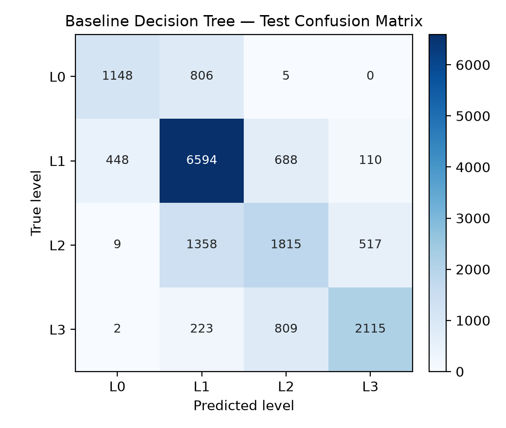

# 1. Introduction

## 1.1 Two kinds of bad air

Klang Valley air mixes two processes. One is local and repeats: about 25 µg/m³ at midday and
about 64 µg/m³ late evening as the boundary layer collapses. The other is imported. From June to
October the south-west monsoon carries smoke from Sumatran and Bornean peat fires across the
Strait of Malacca; in the test window receptors rose 128.3 µg/m³ inside three hours and stayed
above 100 µg/m³ for 281 hours. The first is background; the second closes schools [5].

## 1.2 Why the published index cannot do this job

Malaysia reports PM2.5 as a 24-hour moving average, the Air Pollutant Index [1] — right for
regulation, wrong for a three-hour decision. If PM2.5 jumps from 25 to 95 µg/m³ at 14:00, the
24-hour mean moves about 3 µg/m³, because 23 of its hours are still clean. The index also
reports a level, not a direction, and a downward miss costs 8 to 15 times more than an upward
one [8].

## 1.3 Objectives and scope

We build a three-hour-ahead PM2.5 risk nowcast with four ordered levels; this section covers the
panel (O1) and the climatological baseline (O2). Three limits apply. The composition field is a
CAMS model product at 0.4°, not a measurement; KL_City averages 40.29 µg/m³, 2.7 times the WHO
24-hour guideline [2]. The 26 cells are model cells, not stations; the test window contains a
haze episode.

# 2. Data and evaluation protocol

## 2.1 Data acquisition and quality control

### 2.1.1 Sources and retrieval

Two Open-Meteo endpoints, no credentials, so the retrieval reproduces [6]: CAMS composition [3]
at 0.4° (≈45 km) and an ERA5-family archive [4], hourly from August 2022 to October 2026 — 26
nodes × 37,272 hours.

### 2.1.2 Spatial unit

Thirty-three candidates reduced to 26 cells: comparing one month of hourly PM2.5 showed that 8
Klang Valley sites share 3 cells. An upwind index between two points inside one cell returns the
target's own value, so the domain was extended to Sumatra and Borneo; leave-one-node-out
validation needs distinct cells, or three identical label sequences leak.


*Figure 1. The 26 grid cells. Receptor cells (red squares) are the prediction targets;
corridor cells (orange) serve as both targets and advection sources; source cells (blue
triangles) enter only as features. The inset shows the three Klang Valley cells that eight
candidate sites resolve onto.*

| Node | Region | Role | Lat | Lon | Rows | Mean PM2.5 | Level 3 share |
|---|---|---|---|---|---|---|---|
| KL_City | KL | receptor | 3.107 | 101.726 | 37,183 | 40.29 | 21.64 % |
| Port_Klang | KL | receptor | 3.000 | 101.392 | 37,183 | 20.81 | 1.94 % |
| Sepang | KL | receptor | 2.828 | 101.703 | 37,183 | 34.07 | 13.03 % |
| Seremban | Peninsula | corridor | 2.729 | 101.938 | 37,183 | 19.63 | 2.29 % |
| Malacca | Peninsula | corridor | 2.189 | 102.250 | 37,183 | 13.76 | 1.27 % |
| Johor_Bahru | Peninsula | corridor | 1.492 | 103.741 | 37,183 | 20.67 | 2.86 % |
| Kuantan | Peninsula | corridor | 3.807 | 103.326 | 37,183 | 11.41 | 0.46 % |
| Temerloh | Peninsula | corridor | 3.450 | 102.417 | 37,183 | 14.23 | 0.81 % |
| Kota_Bharu | Peninsula | corridor | 6.125 | 102.238 | 37,183 | 12.88 | 0.06 % |
| Kuala_Terengganu | Peninsula | corridor | 5.330 | 103.140 | 37,183 | 12.67 | 0.14 % |
| Penang | Peninsula | corridor | 5.414 | 100.329 | 37,183 | 18.11 | 0.64 % |
| Alor_Setar | Peninsula | corridor | 6.118 | 100.368 | 37,183 | 14.64 | 0.32 % |
| Ipoh | Peninsula | corridor | 4.597 | 101.090 | 37,183 | 16.10 | 0.87 % |
| Banda_Aceh | Sumatra | source | 5.548 | 95.324 | 37,183 | 10.80 | 0.04 % |
| Medan | Sumatra | source | 3.595 | 98.672 | 37,183 | 30.96 | 8.09 % |
| Dumai | Sumatra | source | 1.666 | 101.450 | 37,183 | 18.86 | 4.35 % |
| Pekanbaru | Sumatra | source | 0.507 | 101.447 | 37,183 | 20.22 | 3.27 % |
| Padang | Sumatra | source | −0.949 | 100.354 | 37,183 | 16.55 | 1.12 % |
| Jambi | Sumatra | source | −1.610 | 103.613 | 37,183 | 18.38 | 3.26 % |
| Palembang | Sumatra | source | −2.976 | 104.775 | 37,183 | 18.85 | 3.43 % |
| Bengkulu | Sumatra | source | −3.800 | 102.265 | 37,183 | 9.98 | 0.00 % |
| Pontianak | Borneo | source | −0.026 | 109.342 | 37,183 | 19.06 | 5.42 % |
| Palangkaraya | Borneo | source | −2.209 | 113.917 | 36,831 | 25.85 | 6.58 % |
| Banjarmasin | Borneo | source | −3.319 | 114.590 | 37,183 | 15.28 | 1.85 % |
| Kuching | Borneo | source | 1.553 | 110.359 | 37,183 | 17.13 | 2.85 % |
| Bintulu | Borneo | source | 3.171 | 113.041 | 37,183 | 10.51 | 0.65 % |

*The 26 cells. Level 3 share is the proportion of rows whose three-hour-ahead target
reaches 55 µg/m³. Palangkaraya has 352 fewer rows because of a 37-hour gap kept as a gap.*

### 2.1.3 Variables and units

Six pollutants in µg/m³ (CO is not ppm here), plus weather, wind speed converted from km/h to
m/s. The km/h default would have inflated advection weights by 3.6; wind direction is circular,
so sine and cosine are derived.

### 2.1.4 Quality control

| Step | Rule | Count |
|---|---|---|
| 1 | drop duplicate `(station_id, timestamp)`, keep first | 0 rows |
| 2 | rebuild a complete hourly index with `reindex` | 0 rows added |
| 3 | trim the leading null block at the CAMS archive edge | 2,080 rows |
| 4 | set values outside physical bounds to NaN | 0 violations |
| 5 | linear interpolation of interior gaps of at most 3 hours | 299 cells in 264 rows |
| 6 | flag rows with any variable still null | 489 rows |
| 7 | drop boundary rows whose label falls in the next split | 156 rows |
| 8 | drop rows without a valid target or a PM2.5 anchor | 328 + 102 rows |

Interpolation is linear, interior, at most three hours; longer gaps stay NaN. A plain
`interpolate(limit=3)` would have filled the first three cells of Palangkaraya's 37-hour gap.
The rows reconcile: 969,072 − 2,080 − 156 − 328 − 102 = **966,406 rows**, 99.72 % retained. Both
rules were fixed after external review and every result recomputed.

### 2.1.5 The model-run boundary

CAMS issues two runs a day, at 00 and 12 UTC, each overwriting later hours of the previous, so a
joined series steps at 08:00 and 20:00 local time. Across 26 nodes the mean absolute hourly
change there is 5.82 µg/m³ against 1.69 (3.45×); at KL_City 15.17 against 4.72 (3.22×), +17.93
at 20:00. Three checks rule out weather: the anomaly ratio stays at 3.02, 79 % of nodes move
together at 20:00 against 45 %, and the first difference is constant in only 1.2 % of three-hour
blocks. The seam is declared, not smoothed, having no reference series.


*Figure 2. Hour-to-hour change in PM2.5 by hour of day. (a) Mean absolute change; the two
shaded hours are the run boundaries. (b) Signed change at KL_City; the 20:00 step is
upward, not symmetric.*

### 2.1.6 Targets

Targets come from `groupby("station_id").shift(-3)`: concentration three hours ahead and its
band at **15, 35 and 55 µg/m³**; the first cut is the WHO 24-hour guideline [2]. High risk means
L2 ∪ L3.

### 2.1.7 Gate 0: feasibility before modelling

| Gate | Criterion | Result | Verdict |
|---|---|---|---|
| G0-1 | ≥ 100,000 rows, ≥ 12,000 per node | 966,406 rows; minimum 36,831 | pass |
| G0-2 | receptor Level 3 share ≥ 1 % | 12.21 % (panel 3.35 %) | pass |
| G0-3 | longest receptor gap ≤ 24 h | 5 h (panel maximum 37 h) | pass |
| G0-4 | train/test Level 3 ratio ≤ 3× | 11.13 % against 18.85 % (1.69×) | pass |

Two gates use receptors only; source cells dilute the target. All pass; the 1.69× ratio shows
the test window is not exchangeable with training.

## 2.2 Climatological baseline and chronological splitting

### 2.2.1 Why subtract a baseline

A model given raw concentrations and a month index learns that September is hazier than
November, then fails on the event it exists for. We subtract the (station, month, hour) mean —
7,488 cells, floor 30 — and the same for temperature, on training rows only: over the full panel
it would leak future information.

### 2.2.2 Chronological splitting

Splits follow each node's time axis by timestamp percentiles, so a missing hour cannot move a
boundary.

| Split | Window | Rows (panel) | Receptor rows | Permitted use |
|---|---|---|---|---|
| train | 2022-08-04 → 2025-07-23 | 676,806 | 78,093 | fitting, cross-validation |
| validation | 2025-07-24 → 2026-03-13 | 144,976 | 16,728 | model and threshold selection |
| test | 2026-03-13 → 2026-10-31 | 144,624 | 16,728 | final reporting, once |

Cross-validation is five folds cut at unique timestamps inside training, climatology refitted
per fold. Boundary rows whose label falls into the next split are dropped (156), not moved;
every model uses 77,744 / 16,647 / 16,647 rows.

### 2.2.3 What the test window contains

The test split contains the August–October 2026 episode: at KL_City Level 3 reaches 46.94 % in
September and 51.01 % in October. The scores measure an event, and the test set is harder (18.85
% against 11.13 %).

### 2.2.4 Baseline models

M0 is persistence: the current band, three hours forward. M1 is one decision tree [7] on
current-hour observations only: 18 columns, no lag and no spatial term. Hyperparameters (gini,
depth 9, leaf 20) come from an earlier grid whose folds were cut by row order (KD-05). The
five-fold estimate is 0.6277 (sd 0.0107).

| Metric | M0 persistence | M1 decision tree | Δ (M1 − M0) |
|---|---|---|---|
| Macro-F1 | 0.6231 | **0.6658** | +0.0427 |
| Balanced accuracy | 0.6232 | **0.6473** | +0.0241 |
| High-risk recall (L2 ∪ L3) | **0.7757** | 0.7675 | **−0.0082** |
| Mean absolute ordinal error | 0.3925 | **0.3199** | −0.0726 |
| Severe jumping error rate | 0.0374 | **0.0210** | −0.0164 |
| Average asymmetric cost | 0.9978 | **0.9047** | −0.0931 |

*Baseline comparison on the test split, 16,647 receptor rows of which 6,848 are high risk.*

High-risk recall alone fails to improve. It is the union version, Pr(ŷ ∈ {2,3} | y ∈ {2,3}), so
a true L2 reported as L3 counts as a hit; the tree hedges downward, with `pm2_5` holding 66.7 %
of the split mass and `hour` 18.1 %.



*Figure 3. M1 confusion matrix. The mass sits above the diagonal: L2 hours are reported as
L3, which protects recall for the wrong reason.*

| Node | Macro-F1 | High-risk recall | Average cost | Level 3 share |
|---|---|---|---|---|
| KL_City | 0.6039 | **0.8032** | 1.1079 | 21.64 % |
| Port_Klang | **0.6827** | 0.6724 | 0.6289 | 1.94 % |
| Sepang | 0.6224 | 0.7628 | 0.9773 | 13.03 % |

*M1 by receptor node. The cleanest node is the worst on recall.*

### 2.2.5 Reproduction

```bash
python src/01_data_pipeline.py --fetch      # retrieve, clean, baseline, Gate 0
python src/01_verify_data.py --check        # 17 contract checks
python src/01_baseline_dt.py --eligibility data/feat_spatiotemporal.parquet
```

## References

[1] Department of Environment, Malaysia. *Air Pollutant Index (API).* Putrajaya: DOE.
https://www.doe.gov.my?p=19344/ (accessed November 2026).

[2] World Health Organization. *WHO global air quality guidelines: particulate matter
(PM2.5 and PM10), ozone, nitrogen dioxide, sulfur dioxide and carbon monoxide.* Geneva:
WHO, 2021. ISBN 978-92-4-003422-8.

[3] Copernicus Atmosphere Monitoring Service. *CAMS global atmospheric composition
forecasts.* ECMWF. https://confluence.ecmwf.int/display/CKB/CAMS+global+atmospheric+composition+forecasts

[4] Hersbach, H., Bell, B., Berrisford, P., et al. The ERA5 global reanalysis.
*Quarterly Journal of the Royal Meteorological Society*, 146(730), 1999–2049, 2020.
doi:10.1002/qj.3803

[5] Field, R. D., van der Werf, G. R., Fanin, T., et al. Indonesian fire activity and
smoke pollution in 2015 show persistent nonlinear sensitivity to El Niño-induced drought.
*Proceedings of the National Academy of Sciences*, 113(33), 9204–9209, 2016.
doi:10.1073/pnas.1524888113

[6] Open-Meteo. *Historical weather and air quality API documentation.*
https://open-meteo.com/en/docs (accessed November 2026).

[7] Breiman, L., Friedman, J., Olshen, R., Stone, C. *Classification and Regression Trees.*
Belmont: Wadsworth, 1984.

[8] Elkan, C. The foundations of cost-sensitive learning. In *Proceedings of the 17th
International Joint Conference on Artificial Intelligence*, 973–978, 2001.
