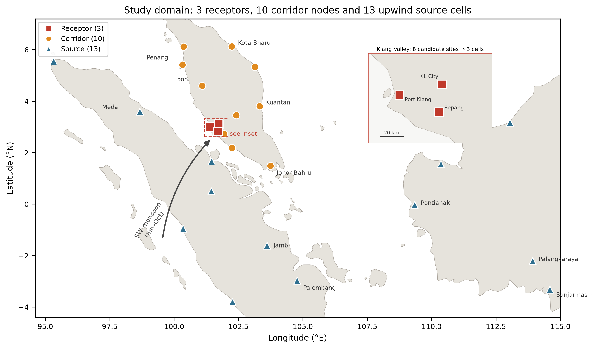
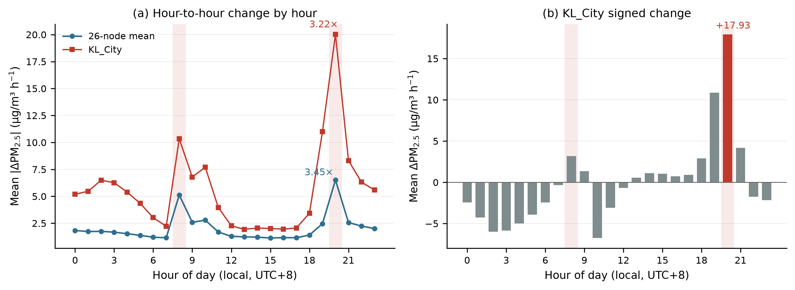
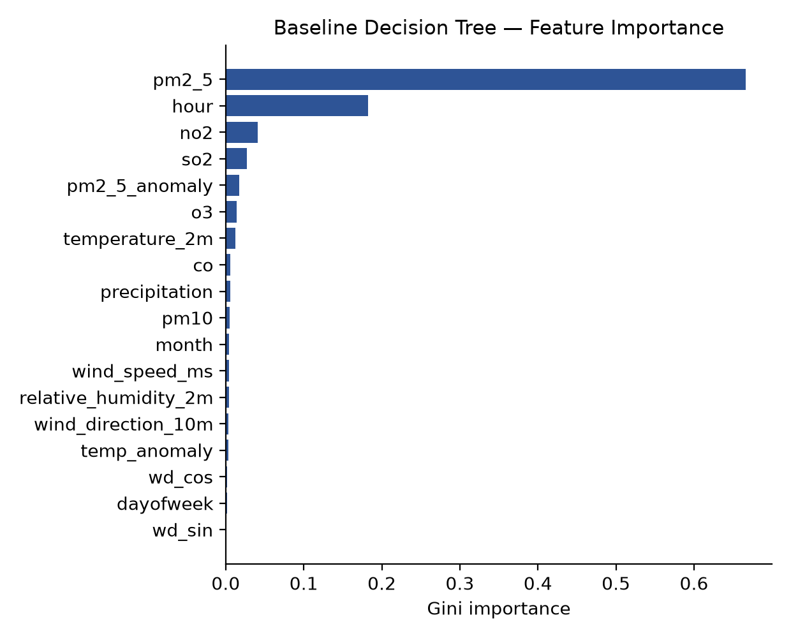

# 1. Introduction

## 1.1 Two kinds of bad air

Air quality in the Klang Valley is the sum of two processes that look similar on a
monitor and behave nothing alike.

The first is local and repeats. Concentrations fall to about 25 µg/m³ around midday, when
the boundary layer is deep, and climb to about 64 µg/m³ late in the evening once it
collapses; part of that evening rise is the run seam of Section 2.1.5, not weather. Because the cycle repeats, a model can learn it from a few months of history,
and so can a person who cycles to work every day.

The second is imported. Between June and October the south-west monsoon carries smoke
from peat and forest fires in Sumatra and Borneo across the Strait of Malacca. In the
2026 season the receptor series in our test window rose by 128.3 µg/m³ inside three hours
and spent 281 hours above 100 µg/m³ (Section 2.2.3). Nothing local predicts the
timing of that. The fires are set for land clearing, they smoulder underground for weeks,
and the smoke arrives when the wind decides it will [5].

The two call for different responses. The first is background; the second is what closes
schools, cancels outdoor events and fills emergency departments. This project is about the
second, and about giving enough warning to act before it arrives.

## 1.2 Why the published index cannot do this job

Malaysia reports air quality as the Air Pollutant Index (API), published hourly by the
Department of Environment. For PM2.5 the index is computed from a **24-hour moving
average** [1]. That is a reasonable choice for regulatory reporting. A 24-hour mean
smooths short spikes, is comparable across stations, and matches the averaging time of
the health evidence behind it.

For a decision due in the next three hours it fails, for two separate reasons.

The average lags the air. If a haze front lifts PM2.5 from 25 to 95 µg/m³ at 14:00, the
24-hour mean moves by about 3 µg/m³, because 23 of its 24 hours are still clean air. The
published number therefore crosses into the unhealthy band several hours after the air
itself did. Visibility, which reflects the current hour, can deteriorate while the index
has barely moved.

The index also reports a level, not a direction. A reading answers "how bad is it now".
At 07:00 the question is a different one: what will it be at 10:00. Answering that needs
a forecast at a stated horizon, and it needs a statement of how much to trust it.

There is a third issue, which becomes important in Section 2.2.4. The four API bands are
ordered, and the two directions of error do not cost the same. Telling someone the air is
moderate when it is in fact very unhealthy is worse than the reverse mistake, and by a
wide margin: our cost matrix charges 8 to 15 times more for a downward miss than for an
upward one (Section 3). A model that treats the four bands as unrelated categories throws
away both the ordering and the asymmetry [8].

## 1.3 Objectives

The project develops and evaluates a three-hour-ahead PM2.5 risk nowcast for the Klang
Valley, with four ordered output levels and an interval around the concentration
estimate. The parts covered in this section are:

- **O1** build a leakage-free hourly panel of composition and meteorology for the valley
  and its upwind source regions, with a declared spatial unit and a declared quality
  control procedure;
- **O2** remove the climatological background, so that the model has to explain deviation
  from normal rather than which month it is;
- **O5** leave a pipeline another group can rerun, including the parts that did not work.

Objectives O3 (model comparison) and O4 (generalisation to unseen nodes and years) belong
to Sections 2.6 to 2.8 and 3, and are not evaluated here.

## 1.4 Scope, and what these numbers can support

Two limitations belong here rather than in a conclusion, because both change how every
number in this section should be read.

**The pollutant fields are model output, not monitor readings.** They come from the CAMS
global atmospheric composition product, distributed through Open-Meteo, at a native
resolution of 0.4° (about 45 km) [3]. They are grid-cell estimates from a chemistry and
transport model, not measurements from a DOE station. For regional transport, which
happens over hundreds of kilometres, that is adequate. For exposure at street level it is
not, and we make no claim of that kind. A comparison with the published API is also
compromised in one direction: the CAMS surface field at `KL_City` averages 40.29 µg/m³
over the panel, about 2.7 times the 24-hour guideline value [2], which is the usual
signature of a coarse grid that cannot resolve ventilation in a basin.

**The spatial unit is a grid cell, not a station.** Because 45 km is wider than the
Klang Valley itself, the eight administrative sites proposed at the start of the project
collapse onto three distinct grid cells, with numerically identical series inside each
one. Rather than report eight "stations" that are in truth three, we re-identified the
spatial unit, extended the domain to the upwind source regions, and checked cell
distinctness by direct comparison of the retrieved series (Section 2.1.2). The panel that
results has 26 genuinely distinct cells.

The test window also contains a real haze episode, so the scores below measure an event
rather than background noise. Section 2.2.3 quantifies how much harder that window is than
the training distribution.

# 2. Data and evaluation protocol

The remaining sections share one panel, one split and one metric implementation. This
chapter fixes those three things before any model is compared, because a comparison
between models is only as meaningful as the data contract underneath it.

## 2.1 Data acquisition and quality control

### 2.1.1 Sources and retrieval

Two Open-Meteo endpoints were used. Neither requires authentication, so a reader with no
credentials can reproduce the retrieval [6].

| Endpoint | Variables | Product | Native resolution |
|---|---|---|---|
| `air-quality-api.open-meteo.com` | PM2.5, PM10, NO₂, SO₂, O₃, CO | CAMS global composition [3] | 0.4° (~45 km) |
| `archive-api.open-meteo.com` | 2 m temperature, relative humidity, 10 m wind speed and direction, precipitation | ERA5-family reanalysis [4] | returns a grid cell, not the requested point |

The retrieval window runs from 1 August 2022 to 31 October 2026, hourly, in
`Asia/Kuala_Lumpur` (UTC+8). The start date is not arbitrary: the CAMS archive begins on
1 August 2022, and the first 80 hours of that month come back null for every pollutant,
for every node. Those rows are trimmed rather than interpolated (Section 2.1.4), because
a data-availability edge is not a measurement gap.

Volume: 26 nodes × 37,272 hours = **969,072 station-hours**.

The two fields do not share a resolution, and the difference matters later. The
air-quality endpoint returns a grid value per 0.4° cell, so nearby coordinates can return
a series that is identical to the last bit. The archive endpoint returns the centre of
the grid cell that contains the requested coordinate, and that grid is much finer: the
three receptor cells, which sit within about 45 km of each other, receive three different
temperature and wind series. Weather therefore separates sites that the composition field
merges, which is why the domain could be extended at all.

### 2.1.2 Spatial unit: what a grid cell can resolve

This subsection documents the decision that changed the project.

Thirty-three candidate coordinates were placed across Peninsular Malaysia, Sumatra and
Borneo. For each, one month of hourly PM2.5 was retrieved (July 2025) and the series
were compared pairwise for exact equality. Candidates whose series matched to the last
decimal were treated as one cell and represented by one node, chosen for name recognition
rather than for position.

| Candidate group | Candidates | Distinct cells |
|---|---|---|
| Klang Valley sites | 8 | **3** |
| Peninsular corridor | 12 | 10 |
| Sumatra | 8 | 8 |
| Borneo | 5 | 5 |
| **Total** | **33** | **26** |

Inside a cell the hourly series are bit-identical across all six pollutants, which is what
a single grid value looks like when it is served to several coordinates. The eight valley
names reduce to `KL_City` (four), `Sepang` (three) and `Port_Klang` (one): `Batu_Muda`,
`Petaling_Jaya` and `Shah_Alam` share the city-centre cell, and `Putrajaya` and `Banting`
share Sepang's.

Two design consequences followed.

The advection feature needs regional separation, not municipal separation. Computing an
"upwind" index between two coordinates inside one cell returns the target's own value and
nothing else. The domain was therefore extended to Sumatra and Borneo, which is the
physically correct scale for transboundary haze in any case.

Leave-one-node-out validation needs distinct cells. Holding out one of eight valley
"stations" would leak the answer, because three siblings in the same cell carry an
identical label sequence. With 26 distinct cells the experiment recovers its meaning
(Section 3).

Figure 1 shows the domain. The inset is the point of the figure: three markers that were
eight sites in the original proposal.



*Figure 1. The 26 grid cells used in this study. Receptor cells (red squares) are the
prediction targets; corridor cells (orange) serve as both targets and advection sources;
source cells (blue triangles) enter only as features. The inset shows the three Klang
Valley cells that eight candidate sites resolve onto.*

The table below lists all 26. The mean PM2.5 column is there to make one thing visible
early: the receptor cells differ by a factor of two (40.29 against 20.81 µg/m³), so a
single pooled error statistic will describe the city and say nothing useful about the port.

| Node | Region | Role | Lat | Lon | Rows | Mean PM2.5 | Level 3 share |
|---|---|---|---|---|---|---|---|
| KL_City | KL | receptor | 3.107 | 101.726 | 37,183 | 40.29 | 21.64 % |
| Port_Klang | KL | receptor | 3.000 | 101.392 | 37,183 | 20.81 | 1.94 % |
| Sepang | KL | receptor | 2.828 | 101.703 | 37,183 | 34.07 | 13.03 % |
| Seremban | Peninsula | corridor | 2.729 | 101.938 | 37,183 | 19.63 | 2.29 % |
| Malacca | Peninsula | corridor | 2.189 | 102.250 | 37,183 | 13.76 | 1.27 % |
| Johor_Bahru | Peninsula | corridor | 1.492 | 103.741 | 37,183 | 20.67 | 2.86 % |
| Kuantan | Peninsula | corridor | 3.807 | 103.326 | 37,183 | 11.41 | 0.46 % |
| Temerloh | Peninsula | corridor | 3.450 | 102.417 | 37,183 | 14.23 | 0.81 % |
| Kota_Bharu | Peninsula | corridor | 6.125 | 102.238 | 37,183 | 12.88 | 0.06 % |
| Kuala_Terengganu | Peninsula | corridor | 5.330 | 103.140 | 37,183 | 12.67 | 0.14 % |
| Penang | Peninsula | corridor | 5.414 | 100.329 | 37,183 | 18.11 | 0.64 % |
| Alor_Setar | Peninsula | corridor | 6.118 | 100.368 | 37,183 | 14.64 | 0.32 % |
| Ipoh | Peninsula | corridor | 4.597 | 101.090 | 37,183 | 16.10 | 0.87 % |
| Banda_Aceh | Sumatra | source | 5.548 | 95.324 | 37,183 | 10.80 | 0.04 % |
| Medan | Sumatra | source | 3.595 | 98.672 | 37,183 | 30.96 | 8.09 % |
| Dumai | Sumatra | source | 1.666 | 101.450 | 37,183 | 18.86 | 4.35 % |
| Pekanbaru | Sumatra | source | 0.507 | 101.447 | 37,183 | 20.22 | 3.27 % |
| Padang | Sumatra | source | −0.949 | 100.354 | 37,183 | 16.55 | 1.12 % |
| Jambi | Sumatra | source | −1.610 | 103.613 | 37,183 | 18.38 | 3.26 % |
| Palembang | Sumatra | source | −2.976 | 104.775 | 37,183 | 18.85 | 3.43 % |
| Bengkulu | Sumatra | source | −3.800 | 102.265 | 37,183 | 9.98 | 0.00 % |
| Pontianak | Borneo | source | −0.026 | 109.342 | 37,183 | 19.06 | 5.42 % |
| Palangkaraya | Borneo | source | −2.209 | 113.917 | 36,831 | 25.85 | 6.58 % |
| Banjarmasin | Borneo | source | −3.319 | 114.590 | 37,183 | 15.28 | 1.85 % |
| Kuching | Borneo | source | 1.553 | 110.359 | 37,183 | 17.13 | 2.85 % |
| Bintulu | Borneo | source | 3.171 | 113.041 | 37,183 | 10.51 | 0.65 % |

*The 26 cells. Level 3 share is the proportion of rows whose three-hour-ahead
target reaches or exceeds 55 µg/m³. Palangkaraya has 352 fewer rows because of a 37-hour
gap that is retained rather than interpolated (Section 2.1.7).*

### 2.1.3 Variables and units

| Variable | Unit delivered | Unit used | Note |
|---|---|---|---|
| `pm2_5`, `pm10`, `no2`, `so2`, `o3`, `co` | µg/m³ | µg/m³ | CO is **not** in ppm on this endpoint |
| `wind_speed_10m` | km/h | m/s (÷ 3.6) | the km/h column is kept as `wind_speed_kmh` for audit |
| `temperature_2m` | °C | °C | — |
| `relative_humidity_2m` | % | % | — |
| `precipitation` | mm | mm | — |
| `wind_direction_10m` | degrees, 0 = north, clockwise | degrees, plus sine and cosine | circular quantity, see below |

Two unit traps were handled explicitly. The wind-speed default of km/h would have inflated
the advection weights by 3.6 without raising an error, and carbon monoxide arriving in
µg/m³ rather than ppm would have mis-scaled any ratio computed against it. Wind direction
is circular (359° and 1° are 2° apart, not 358°), so `wd_sin` and `wd_cos` are derived;
passing raw degrees to a tree invites a split at the 0/360 boundary.

### 2.1.4 Quality control

Applied per node, in this order.

| Step | Rule | Count |
|---|---|---|
| 1 | drop duplicate `(station_id, timestamp)`, keep first | 0 rows |
| 2 | rebuild a complete hourly index with `reindex` | 0 rows added |
| 3 | trim the leading null block at the CAMS archive edge | 2,080 rows (80 h × 26 nodes) |
| 4 | set values outside physical bounds to NaN | 0 violations |
| 5 | linear interpolation of interior gaps of at most 3 hours | 299 cells in 264 rows |
| 6 | flag rows with any variable still null (`is_missing`) | 489 rows |
| 7 | drop boundary rows whose label falls in the next split (3-hour purge) | 156 rows |
| 8 | drop rows without a valid target or without a current PM2.5 anchor | 328 + 102 rows |

Step 2 matters more than its zero suggests. Without a complete index, `shift(1)` means
"the previous row", not "one hour ago", so every lag goes wrong wherever a row is missing.
The reindex adds nothing here only because all 26 nodes arrived complete.

Bounds are PM2.5 [0, 900], PM10 [0, 1,200], NO₂/SO₂/O₃ [0, 500], CO [0, 20,000] µg/m³,
temperature [−20, 50] °C, relative humidity [0, 100] %, wind [0, 60] m/s and
precipitation [0, 300] mm. No value violated them, which is itself informative: the CAMS
field is produced by a model, and model output does not go out of range the way a failing
sensor does.

Interpolation is linear, interior only, at most three consecutive hours. Longer gaps stay
as NaN and are flagged. This is a deliberate refusal to extrapolate: a 37-hour gap at
`Palangkaraya` is kept as a gap, because filling it would have manufactured a haze
episode that never happened.

Counts in steps 3 to 6 are taken at the moment they are applied, before steps 7 and 8
remove rows. That is why `src/01_verify_data.py`, which recounts the finished panel,
reports 182 interpolated rows rather than 264: 82 of the interpolated rows are among the
586 rows dropped at the end.

The counts reconcile exactly: 969,072 fetched − 2,080 trimmed − 156 across a split
boundary − 328 without a target − 102 without an anchor = **966,406 rows**, a retention
of 99.72 %. The 102 rows are the ones that survive interpolation with the current hour
still missing; they cannot be used, because the anomaly and the persistence baseline both
need a value at `t`.

### 2.1.5 A step at the model-run boundary

The composition fields are not a continuous measurement. They are assembled from
successive forecast runs. The CAMS global forecast is issued twice a day, at 00 and 12
UTC, and each new run overwrites the later forecast hours of the previous one. The two
runs start from different initial states and do not agree exactly, so a long hourly series
joined from them contains a step that belongs to the production system rather than to the
atmosphere.

In local time those boundaries fall at 08:00 and 20:00. The step is easy to see in the
first difference of PM2.5.



*Figure 2. Hour-to-hour change in PM2.5, by hour of day. Panel (a): mean absolute change;
the two shaded hours are the forecast-run boundaries. Panel (b): signed change at
`KL_City`; the jump at 20:00 is upward, not symmetric.*

Across all 26 nodes, the mean absolute hour-to-hour change at 08:00 and 20:00 is 5.82
µg/m³ against 1.69 at all other hours, a factor of 3.45. At `KL_City` the contrast is
sharper: 15.17 against 4.72, a factor of 3.22, and the signed change at 20:00 there is
+17.93 µg/m³. The series steps up; it does not scatter in both directions.

Three checks separate this from weather or from the diurnal cycle.

It survives removal of the climatology. Repeating the statistic on `pm2_5_anomaly` at
`KL_City` moves the ratio from 3.22 only to 3.02. A diurnal cycle would disappear here.

It happens across the network at once. At 20:00, 79 % of the 26 nodes change in the same
direction, against 45 % at other hours. Local weather does not synchronise a coastline.

Every pollutant jumps at the same two hours. Relative to background hours, the absolute
change is 3.23× for PM10, 2.35× for NO₂, 2.32× for SO₂, 1.88× for CO and 1.81× for O₃.

We also tested whether the hourly values are interpolated from a three-hourly field. They
are not: within a three-hour block the first difference is constant in only 1.2 % of
blocks, and the mean absolute second difference grouped by hour modulo three is 6.07, 5.17
and 6.04. Linear interpolation from three-hourly nodes would produce the opposite
pattern.

The seam is declared, not corrected. Removing it needs an independent reference series,
which we do not have. Two effects follow. A target whose three-hour lead crosses 20:00
inherits part of the step, so targets issued between 17:00 and 19:00 carry error that no
model can anticipate from the inputs at issue time. The anomaly series inherits the same
step, so anomaly magnitudes near the seam need care.

`tools/check_run_seam.py` reproduces every number in this subsection.

### 2.1.6 Targets

Both targets are built with `groupby("station_id")["pm2_5"].shift(-3)`:

- `target_pm25_3h`, the concentration three hours ahead;
- `target_level_3h`, its ordinal band, cut at **15, 35 and 55 µg/m³**.

The cut points are ours, not a regulatory scale. The lower one is the WHO 2021 24-hour
guideline for PM2.5 [2]; the upper two sit between the WHO interim targets, at round
values that are easy to communicate. The four levels are named Low, Moderate, High and
Very High in the code and L0 to L3 in the results, and "high risk" always means L2 ∪ L3.

The `groupby` is not incidental. A global `shift(-3)` would concatenate the tail of one
node to the head of the next, manufacturing labels that mix two locations. Nothing would
crash: the code runs, the model trains, and only the metrics are wrong.

### 2.1.7 Gate 0: feasibility before modelling

Four checks run before any model is fitted. Two are evaluated on receptor nodes only,
because pooling in the low-concentration source cells would dilute the target
distribution and read inter-annual variability as drift.

| Gate | Criterion | Result | Verdict |
|---|---|---|---|
| G0-1 | ≥ 100,000 rows, ≥ 12,000 per node | 966,406 rows; minimum 36,831 | pass |
| G0-2 | receptor Level 3 share ≥ 1 % | 12.21 % (panel 3.35 %) | pass |
| G0-3 | longest receptor gap ≤ 24 h | 5 h (panel maximum 37 h at `Palangkaraya`) | pass |
| G0-4 | train/test Level 3 ratio ≤ 3× | 11.13 % against 18.85 % (1.69×) | pass |

G0-3 is formulated on receptors on purpose: a gap in a source node corrupts a feature,
while a gap in a receptor node corrupts the label itself. The 37-hour gap is disclosed
rather than patched for that reason.

G0-4 passes, but it is also the first sign that the test window is not exchangeable with
training. Section 2.2.3 deals with that directly.

## 2.2 Climatological baseline and chronological splitting

### 2.2.1 Why subtract a baseline

PM2.5 has a strong seasonal and daily pattern. A model given raw concentrations and a
month index can reach a respectable accuracy by learning that September is hazier than
November, without representing transport at all. It will also look fine in sample and
then fail on an unusual event, which is the case the system exists for.

The baseline removes the predictable part so that the model has to explain the residual:

$$b_{\text{proto}}(s, m, h) = \mathbb{E}\left[\text{PM}_{2.5} \mid \text{station}=s,\ \text{month}=m,\ \text{hour}=h\right]$$

$$a(t) = x(t) - b_{\text{proto}}(s, m(t), h(t))$$

The same operation is applied to 2 m temperature, giving `temp_anomaly`, which records
whether the boundary layer is unusually warm (convective, dispersive) or unusually cool
(stable, accumulating).

Two implementation details matter more than the formula.

The baseline is fitted on the training split only, then broadcast to validation and test.
Computing it over the full panel leaks future information into training features through
the group means, which is the least visible form of leakage in time-series work because
nothing about the code looks wrong. The function asserts that its input frame is already
filtered to `split == 'train'`.

A (station, month, hour) cell needs at least 30 observations to stand alone; below that
it falls back to (station, month). The panel has 7,488 such cells, none under the floor,
and the thinnest holds 85 observations.

### 2.2.2 Chronological splitting

Each node is split along its own time axis into 70 % train, 15 % validation and 15 %
test, by timestamp percentiles rather than by row count, so that a missing hour cannot
shift a boundary.

| Split | Window | Rows (panel) | Receptor rows | Permitted use |
|---|---|---|---|---|
| train | 2022-08-04 → 2025-07-23 | 676,806 | 78,093 | baseline fitting, model fitting, cross-validation, hyperparameter search |
| validation | 2025-07-24 → 2026-03-13 | 144,976 | 16,728 | model selection, threshold search, interval calibration |
| test | 2026-03-13 → 2026-10-31 | 144,624 | 16,728 | final reporting, evaluated once |

No shuffling, no `KFold` and no random subsampling appears anywhere in the pipeline. The
only cross-validation used is `TimeSeriesSplit(n_splits=5)` inside the training block, and
it never touches validation or test rows.

After the eligibility audit described in Section 2.4, the receptor rows used by every
model are 77,744 train, 16,647 validation and 16,647 test. The main results table is
computed on those 16,647 rows so that the baselines and the later models are compared on
identical rows.

### 2.2.3 What the test window contains

The test split happens to contain the August to October 2026 haze episode. At `KL_City`
the Level 3 share reaches 46.94 % in September and 51.01 % in October, with a monthly
95th percentile of 151.80 µg/m³ in October. The peak three-hour rise in that window is
128.3 µg/m³.

We kept the split rather than re-drawing it. Two things follow. The scores measure an
event: high-risk recall on this window is not the same quantity as recall on a quiet
month, and it is the one a user would care about. The test set is also harder than
training, with Level 3 at 18.85 % against 11.13 %, and L0 falling from 18.54 % to
11.78 %.

| Split | L0 | L1 | L2 | L3 |
|---|---|---|---|---|
| train | 18.54 % | 50.29 % | 20.05 % | 11.13 % |
| test | 11.78 % | 47.18 % | 22.18 % | 18.85 % |

No class falls below 11 %, so this is not the extreme-rarity regime that motivates most
cost-sensitive literature. The asymmetry that matters here is in the cost matrix, not in
the class frequencies, and we report the shares as they are. Calling this "severe
imbalance" would overstate it.

### 2.2.4 Baseline models: persistence and one decision tree

Two models are fitted before anything else, because the rest of the project only makes
sense against them.

**M0, persistence.** The three-hour-ahead level is set equal to the level now. There is no
learning, no parameters and no fitting. It is included because the natural competitor for
any added complexity is the persistence of the pollutant itself, not an empty model.

**M1, one decision tree** [7]. Current-hour observations only: six pollutants, five
meteorological variables, the two anomalies, three calendar variables and the wind sine
and cosine pair, which is 18 columns. No lag, no rolling statistic, no spatial
aggregation. Hyperparameters are chosen by `TimeSeriesSplit(n_splits=5)` grid search
scored on macro-F1 over `max_depth` ∈ {3, 5, 7, 9, 12, none}, `min_samples_leaf` ∈ {5, 20,
50, 100} and `criterion` ∈ {gini, entropy}, which is 48 configurations. The selected
tree is `gini`, depth 9, minimum leaf 20, giving 384 leaves and a cross-validated
macro-F1 of 0.6281. Training macro-F1 is 0.7013 against 0.6867 on validation, a gap of
0.015, so the tree is not memorising the training set; what it cannot reach comes from
the features.

Results on the test split, receptor nodes, 16,647 rows of which 6,848 are high risk:

| Metric | M0 persistence | M1 decision tree | Δ (M1 − M0) |
|---|---|---|---|
| Macro-F1 | 0.6231 | **0.6658** | +0.0427 |
| Balanced accuracy | 0.6232 | **0.6473** | +0.0241 |
| High-risk recall (L2 ∪ L3) | **0.7757** | 0.7675 | **−0.0082** |
| Mean absolute ordinal error | 0.3925 | **0.3199** | −0.0726 |
| Severe jumping error rate | 0.0374 | **0.0210** | −0.0164 |
| Average asymmetric cost | 0.9978 | **0.9047** | −0.0931 |

*Baseline comparison. Every metric except high-risk recall improves, and high-risk recall
is the one that decides whether an alarm is raised.*

High-risk recall here is the union version, Pr(ŷ ∈ {2,3} | y ∈ {2,3}), which asks whether
a dangerous hour received any high-risk warning. A true L2 predicted as L3 counts as a
hit: that over-warns, it does not under-warn. The per-class version, Pr(ŷ = y | y ∈
{2,3}), is 0.5739 for M1 and is kept as a diagnostic, not as a headline, because
penalising a cautious over-warning contradicts the cost structure the project is built on.
The two definitions differ by about 0.2 absolute, so every table in this report states
which one it uses.

The result that matters is the third row. The tree improves macro-F1 by 0.04, cuts mean
ordinal error by 18 % and cuts average cost by 9 %, and still raises fewer alarms on
dangerous hours than a rule that does nothing. Training a model and losing ground on
"should we warn" is the most useful thing the baseline tells us. It says that aggregate
accuracy is the wrong objective for a warning system.


*Figure 3. M1 confusion matrix on the test split. The mass below the diagonal at L2 and L3
is the mechanism behind the recall loss.*

The confusion matrix shows where it goes. Of 3,699 true L2 hours, 1,358 are predicted as
L1; of 3,149 true L3 hours, 809 are predicted as L2. Errors in the opposite direction are
almost absent: five L0 hours are predicted as L2 and none as L3. The tree suppresses the
upper boundary to accommodate L1, which is roughly half the test set. That is hedging
toward the majority class, not random noise, and it is exactly the behaviour a cost-blind
objective should produce.



*Figure 4. Gini importance of the 18 baseline features. `pm2_5` alone accounts for 66.7 %
and `hour` for 18.1 %.*

The importance profile says the tree is close to a persistence-plus-diurnal rule. `pm2_5`
carries 66.7 % of the split mass and `hour` 18.1 %; `no2` (4.1 %) and `so2` (2.7 %) are
the only meteorological or secondary pollutants that register at all. That is consistent
with the recall failure: the model has learned "tomorrow's air resembles today's air,
adjusted for the time of day", and such a rule has no reason to shout.

Performance is also uneven across the three receptors, and the pattern is physical.

| Node | Macro-F1 | High-risk recall | Average cost | Level 3 share |
|---|---|---|---|---|
| KL_City | 0.6007 | **0.8078** | 1.0791 | 21.64 % |
| Port_Klang | **0.6741** | 0.6724 | 0.6264 | 1.94 % |
| Sepang | 0.6152 | 0.7615 | 0.9659 | 13.03 % |

*M1 by receptor node. The cleanest node is the worst on recall.*

`Port_Klang` scores highest on macro-F1 and lowest on high-risk recall: it is the cleanest
receptor, with a Level 3 share of 1.94 %, so its minority class is the least represented
in training. `KL_City` shows the opposite. A single pooled number would hide both
behaviours, which is why Section 3 reports per-node generalisation.

These three observations set the agenda for the rest of the project. The ordinal
decomposition attacks the downward hedging through cumulative probabilities, the
class-weighted forests trade macro-F1 for recall, and the threshold search moves the
boundary to where the cost matrix says it belongs.

### 2.2.5 Reproduction

```bash
# commands for Sections 2.1 and 2.2
python src/01_data_pipeline.py --fetch      # retrieve, clean, subtract baseline, run Gate 0
python src/01_verify_data.py --check        # 17 contract checks on the panel
python src/01_baseline_dt.py                # M0 and M1, writes models/metrics_stage1.json
python tools/check_run_seam.py              # every number in Section 2.1.5
python src/01_make_figures.py               # Figures 1 and 2
python tools/audit_section1.py              # recompute the numbers quoted in this section
```

`data/raw/` is cached JSON from the two endpoints and is not committed. Re-running
`--fetch` without `--force` reuses the cache, so the panel can be rebuilt offline once
the cache exists. `tools/audit_section1.py` refits M1 on the eligible rows and checks the
stored metrics against the refit; it exits with a mismatch warning rather than silently
agreeing with itself.

## References

[1] Department of Environment, Malaysia. *Air Pollutant Index (API) calculation.*
Putrajaya: DOE, 2021. https://www.doe.gov.my/wp-content/uploads/2021/09/API_Calculation.pdf

[2] World Health Organization. *WHO global air quality guidelines: particulate matter
(PM2.5 and PM10), ozone, nitrogen dioxide, sulfur dioxide and carbon monoxide.* Geneva:
WHO, 2021.

[3] Copernicus Atmosphere Monitoring Service. *Global atmospheric composition
forecasts.* ECMWF. https://confluence.ecmwf.int/display/CKB/CAMS+global+atmospheric+composition+forecasts

[4] Hersbach, H., Bell, B., Berrisford, P., et al. The ERA5 global reanalysis.
*Quarterly Journal of the Royal Meteorological Society*, 146(730), 1999–2049, 2020.

[5] Field, R. D., van der Werf, G. R., Fanin, T., et al. Indonesian fire activity and smoke
pollution in 2015 show persistent nonlinear sensitivity to El Niño-induced drought.
*Proceedings of the National Academy of Sciences*, 113(33), 9204–9209, 2016.

[6] Open-Meteo. *Historical weather and air quality API documentation.*
https://open-meteo.com/en/docs (accessed November 2026).

[7] Breiman, L., Friedman, J., Olshen, R., Stone, C. *Classification and Regression Trees.*
Belmont: Wadsworth, 1984.

[8] Elkan, C. The foundations of cost-sensitive learning. In *Proceedings of the 17th
International Joint Conference on Artificial Intelligence*, 973–978, 2001.
