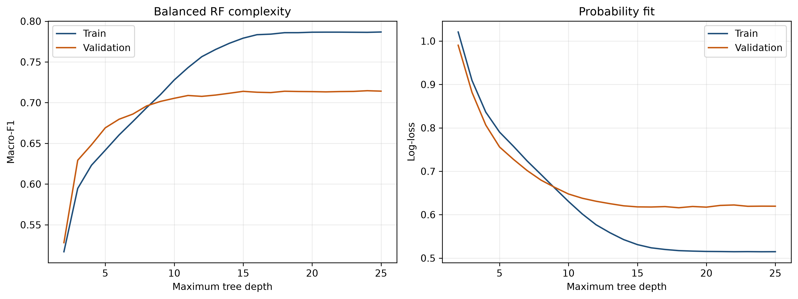
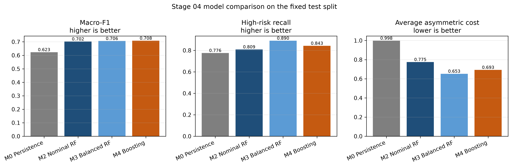
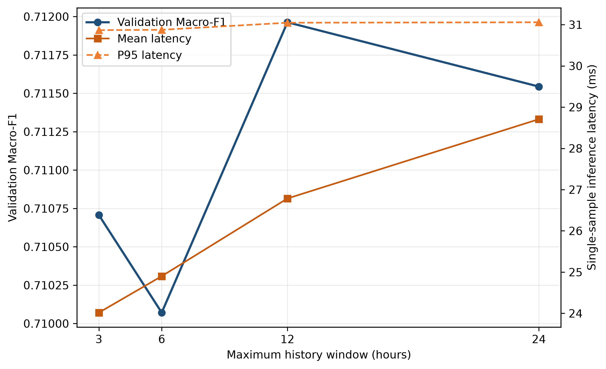

# 2.6 Classification Models M2, M3 and M4

## 2.6.1 Evaluation protocol

The three classifiers were refitted on the corrected receptor-only population and the promoted 25-feature set. The eligible samples comprise 77,744 training rows, 16,647 validation rows and 16,647 test rows from KL_City, Port_Klang and Sepang. These counts match `PANEL_CONTRACT`. Rows were ordered by timestamp and station before fitting. Five time-series folds were formed from unique training timestamps, so observations from different receptors at the same hour stayed in the same fold.

M2 is a nominal random forest with no class weighting. M3 keeps the same forest structure and changes only `class_weight` to `balanced_subsample`. Both fitted models contain 100 trees, use a maximum depth of 14, require 20 samples per leaf and consider half of the input features at each split. M4 is a `HistGradientBoostingClassifier` with a learning rate of 0.03, 400 iterations, 31 maximum leaf nodes and 20 samples per leaf. Early stopping was disabled. This prevents an additional internal validation split from entering the fitted boosting model.

The random-forest search evaluated 12 configurations. The boosting search covered all 24 combinations in its registered grid. Validation Macro-F1 was the primary selection measure. RF candidates also had to use a bounded depth because the corresponding M2 and M3 files must each remain below 20 MiB while sharing all structural parameters. After selection, seeds 42, 43 and 44 were fitted on train and evaluated on validation. The final seed-42 models were then evaluated once on test. The saved record reports `test_evaluation_count=1`.

## 2.6.2 Validation results

Table 1 reports the mean and sample standard deviation across the three validation runs. M4 had the highest validation Macro-F1 at 0.7251. It also produced the lowest MAOE and severe-jump rate. M3 gave the strongest high-risk recall and the lowest asymmetric cost, although its Macro-F1 was lower than those of M2 and M4.

| Model | Macro-F1 | Balanced accuracy | High-risk recall | MAOE | Severe jump rate | Average cost |
|---|---:|---:|---:|---:|---:|---:|
| M2 Nominal RF | 0.7168 ± 0.0011 | 0.6982 ± 0.0005 | 0.7667 ± 0.0019 | 0.2543 ± 0.0012 | 0.0080 ± 0.0004 | 0.6371 ± 0.0027 |
| M3 Balanced RF | 0.7124 ± 0.0010 | 0.7373 ± 0.0009 | 0.8727 ± 0.0002 | 0.2803 ± 0.0013 | 0.0118 ± 0.0002 | 0.5623 ± 0.0024 |
| M4 Boosting | **0.7251 ± 0.0000** | 0.7103 ± 0.0000 | 0.7885 ± 0.0000 | **0.2465 ± 0.0000** | **0.0056 ± 0.0000** | 0.5994 ± 0.0000 |

The zero standard deviations for M4 have a mechanical explanation. This histogram boosting configuration has no stochastic subsampling, and changing `random_state` did not alter its fitted predictions. The result should not be read as evidence that M4 is invariant to a different validation period or receptor population.

The RF depth experiment gives additional context for the deployment choice. M3 validation Macro-F1 rose rapidly through shallow depths, reached 0.7115 at depth 14 and then entered a narrow plateau. The largest scanned value was 0.7147 at depth 24. Training Macro-F1 continued to rise while validation gains became small. The selected depth therefore retains most of the observed validation performance and keeps both forest artifacts within the repository limit.

## 2.6.3 Fixed test comparison

Table 2 gives the single fixed test evaluation. M0 persistence is included as a reference. All three fitted classifiers improved substantially on its Macro-F1 and average asymmetric cost.

| Model | Macro-F1 | Balanced accuracy | High-risk recall | MAOE | Severe jump rate | Average cost |
|---|---:|---:|---:|---:|---:|---:|
| M0 Persistence | 0.6231 | 0.6232 | 0.7757 | 0.3925 | 0.0374 | 0.9978 |
| M2 Nominal RF | 0.7021 | 0.6821 | 0.8088 | 0.2808 | 0.0141 | 0.7747 |
| M3 Balanced RF | 0.7058 | **0.7235** | **0.8900** | 0.2963 | 0.0146 | **0.6527** |
| M4 Boosting | **0.7081** | 0.6945 | 0.8427 | **0.2758** | **0.0110** | 0.6929 |

M3 remains the preferred Stage 04 model under the project's high-risk and asymmetric-cost objective. Relative to M2, `class_weight='balanced_subsample'` increased high-risk recall from 0.8088 to 0.8900 and reduced average asymmetric cost from 0.7747 to 0.6527. These changes are operationally meaningful because missed Level 2 and Level 3 cases receive the larger penalties in the cost matrix.

The improvement is not free. M3's MAOE increased from 0.2808 to 0.2963, a difference of 0.0155. Class weighting moves the decision boundary toward higher predicted risk levels. That raises recall for high-risk cases, but it also creates more upward errors among lower-risk samples. M2 therefore retains a smaller ordinal error than M3, while M3 accepts more over-reporting in exchange for fewer high-risk misses.

M4 was the strongest model on validation, where its Macro-F1 reached 0.7251, and it now also has the highest fixed-test Macro-F1 at 0.7081. Its test MAOE of 0.2758 and severe-jump rate of 0.0110 are the best among M2–M4. Its high-risk recall is 0.8427, however, below M3's 0.8900, and its average cost is also higher. M4 leads the balanced and ordinal-error view; M3 leads the stated high-risk objective.

## 2.6.4 Selection discipline and sensitivity

The corrected refit happens to place M4 first in Macro-F1 on both validation and test. This alignment does not relax the evaluation rule. Selecting a model after inspecting test would convert the final split into another tuning set and make the reported estimate optimistic. All hyperparameters were selected from training folds and validation, and test was evaluated once after the selection was frozen.

Validation contains 4,842 high-risk examples, whereas test contains 6,848. The later period therefore puts more weight on high-risk behaviour. A ranking from one held-out period does not guarantee the same ranking in another, even though the corrected run produced the same Macro-F1 ordering on both. High-risk recall, ordinal error and asymmetric cost should still be read together.

The history-window experiment supports a similar restraint. Using features available within 3 hours gave a validation Macro-F1 of 0.7107. The 6-hour subset gave 0.7101, and the 12-hour subset reached 0.7120. Extending the maximum history to 24 hours added two features but gave 0.7115. Mean single-sample latency ranged from 24.02 to 28.71 ms in the recorded local environment. The 12-hour subset slightly exceeded the full-window score, but the experiment did not use test and does not justify changing the frozen production artifact.

## 2.6.5 QC refit comparison

Table 3 compares the earlier Stage 04 test record with the corrected-panel refit. The metric definitions, test population size, candidate grids, seeds and selection rule are unchanged. RF selected parameters are identical. The frozen validation rule selected an M4 learning rate of 0.03 instead of 0.06 after the data repair.

| Model | Macro-F1 old → new (Δ) | Balanced accuracy old → new (Δ) | High-risk recall old → new (Δ) | MAOE old → new (Δ) | Severe jump old → new (Δ) | Average cost old → new (Δ) |
|---|---:|---:|---:|---:|---:|---:|
| M2 | 0.7014 → 0.7021 (+0.0007) | 0.6824 → 0.6821 (−0.0003) | 0.8094 → 0.8088 (−0.0006) | 0.2813 → 0.2808 (−0.0005) | 0.0138 → 0.0141 (+0.0003) | 0.7700 → 0.7747 (+0.0047) |
| M3 | 0.7018 → 0.7058 (+0.0040) | 0.7206 → 0.7235 (+0.0029) | 0.8873 → 0.8900 (+0.0027) | 0.3003 → 0.2963 (−0.0040) | 0.0146 → 0.0146 (+0.0000) | 0.6512 → 0.6527 (+0.0015) |
| M4 | 0.7005 → 0.7081 (+0.0076) | 0.6871 → 0.6945 (+0.0074) | 0.8332 → 0.8427 (+0.0095) | 0.2858 → 0.2758 (−0.0100) | 0.0135 → 0.0110 (−0.0025) | 0.7250 → 0.6929 (−0.0321) |

The fixed-test changes above 0.005 are confined to M4's Macro-F1, balanced accuracy, high-risk recall, MAOE and average cost. They follow the corrected eligibility rows, the promoted Top-25 set in which `hour_cos` replaces `pm2_5_mean_6h`, and the lower learning rate selected by the unchanged validation rule. This refit does not isolate the contribution of those three changes. On validation, M2's mean average cost also fell by more than 0.005, from 0.6465 to 0.6371, under the corrected rows and feature set.

## 2.6.6 Limitations

The 25 features were selected upstream using the full training split. Feature selection was not repeated inside each time-series fold, so the internal cross-validation scores are not estimates from a fully nested pipeline. Validation and test were excluded from feature selection. All results apply to the three receptor series after the registered eligibility filter; they do not establish performance for corridor or source nodes.

The models operate on retrospective atmospheric-model data and project-defined four-level thresholds. No probability calibration, external-station validation or leave-one-receptor-out analysis was performed in this stage. M3 is therefore the preferred model for the recorded receptor test and cost definition, rather than a universal claim about class-weighted forests. The frozen JSON, model files and figures provide the evidence needed for later cost-sensitive and generalisation analyses without reopening the test set.
